<picture>
  <source media="(prefers-reduced-motion: reduce)" srcset="./assets/profile-hero-still.svg">
  
</picture>

  <a href="https://silviustroe.com"><strong>Website & writing</strong></a> &nbsp; / &nbsp;
  <a href="https://github.com/BrainicHQ"><strong>Brainic</strong></a> &nbsp; / &nbsp;
  <a href="https://www.linkedin.com/in/silviustroe"><strong>LinkedIn</strong></a> &nbsp; / &nbsp;
  <a href="https://x.com/SilviuStroe"><strong>X</strong></a>

# Founder. CTO. Still shipping code.

I'm **Silviu Stroe**, founder and CTO at **[Brainic](https://github.com/BrainicHQ)**, based in **Brașov, Romania**. I build AI products, SaaS platforms, and real-time systems, from the first architecture decision to the production incident that tests it.

My work spans product strategy, technical leadership, and hands-on engineering. I'm equally interested in the business problem, the model's failure modes, and what happens when a UDP packet arrives late.

**Product judgment. Systems depth. A persistent curiosity about AI.**

## Selected work

### 01 / Recenzo — AI for customer reputation

Multi-tenant SaaS for managing Google reviews across business locations. Multilingual LLM replies sit inside a system of **risk classification, content guardrails, and human approval**. RBAC, scheduled sync, background jobs, and retries support the operational side.

`Next.js` `TypeScript` `PostgreSQL` `Prisma` `pg-boss` `Docker` `Cloudflare`

### 02 / DeepHAM — intelligence from audio

Audio transcription, summarization, and search. **Whisper transcribes locally, keeping raw audio off cloud services**; LLM summarization and a searchable dashboard make the output useful. Prompt versioning, caching, deduplication, and idempotent processing keep batch work repeatable.

`Python` `Whisper` `Groq` `Dash`

### 03 / [Latry](https://github.com/s1lviu/Latry) — real-time voice, real networks

A cross-platform VoIP client for the SvxLink amateur radio ecosystem, published on **[iOS](https://apps.apple.com/us/app/latry-a-tiny-svxlink-client/id6751135709)** and **[Android](https://play.google.com/store/apps/details?id=yo6say.latry)**. An Opus audio engine, jitter buffering, and packet-loss handling meet the constraints of mobile networks.

`C++` `Qt / QML` `Opus` `TCP / UDP` `iOS` `Android`

## My technical radar · 2026 → 2027

**My thesis:** the next generation of useful AI products will depend on the quality of the systems around the model. These are directions I'm watching and exploring as I look toward 2027.

| Direction | What interests me |
| :--- | :--- |
| **Agents that can finish the job** | Tool use, durable execution, bounded autonomy, and human approval at consequential steps. |
| **Context as an engineering discipline** | Retrieval, useful memory, and deliberate context selection that keep a system grounded in the task. |
| **Interoperable AI** | [MCP](https://modelcontextprotocol.io/docs/getting-started/intro) for connecting tools and data; [A2A](https://a2a-protocol.org/latest/) for communication between agents. |
| **Quality you can measure** | Task-level evaluations, execution traces, and explicit budgets for latency, cost, and failure. |
| **Voice, local inference, and hybrid systems** | Putting intelligence where privacy, responsiveness, and operating cost make sense. |

<strong>Reading behind the radar</strong>

- [Effective context engineering for AI agents — Anthropic](https://www.anthropic.com/engineering/effective-context-engineering-for-ai-agents)
- [Demystifying evals for AI agents — Anthropic](https://www.anthropic.com/engineering/demystifying-evals-for-ai-agents)
- [Model Context Protocol — official documentation](https://modelcontextprotocol.io/docs/getting-started/intro)
- [Agent2Agent — official documentation](https://a2a-protocol.org/latest/)

## Built in the open

| Project | The problem it tackles |
| :--- | :--- |
| **[DoHSpeedTest](https://github.com/BrainicHQ/DoHSpeedTest)** | Benchmark DNS-over-HTTPS resolvers directly in the browser. |
| **[Tado° Assistant](https://github.com/BrainicHQ/tado-assistant)** | Automate thermostat behavior with a self-hosted smart-home tool. |
| **APRS-Web** | Bring live amateur-radio position reporting to a real-time PWA. |
| **SvxLink VAD work** | Apply Silero voice activity detection to reduce unwanted radio-network activations. |

## The stack behind the work

**Core:** TypeScript · Python · C++ · Next.js · React · PostgreSQL · Docker · Linux  
**AI & audio:** OpenAI-compatible APIs · Whisper · Groq · Silero VAD · Opus  
**Systems:** background jobs · WebSockets · TCP/UDP · multi-tenancy · RBAC · CI/CD

<strong>The wider toolbox</strong>

| Area | Tools I've worked with |
| :--- | :--- |
| Frontend | Angular, Tailwind CSS |
| Backend | Node.js, Express, Flask, Laravel, OpenResty |
| Data | Redis, MongoDB, Neo4j, SQLite, Prisma |
| Mobile | Qt/QML, Flutter, SwiftUI, Kotlin, Capacitor/Cordova |
| Infrastructure | Docker Compose, Cloudflare, Caddy, Nginx, AWS, systemd |
| Communication | Socket.IO, VoIP, audio pipelines |

## How I lead and build

- **Start with the constraint.** Understand the user, the economics, and the failure modes before choosing the architecture.
- **Make AI accountable.** Define success, inspect the output, and keep people in control of consequential decisions.
- **Own the whole system.** Data boundaries, retries, observability, and deployment are part of the product.
- **Keep the code understandable.** Clear interfaces, readable implementations, and small changes help teams move with confidence.
- **Stay close to the work.** Lead the team, review the architecture, and keep building.

---

### Let's build something useful.

Interested in AI products, SaaS architecture, real-time systems, or an open-source collaboration? **[Let's connect on LinkedIn](https://www.linkedin.com/in/silviustroe)** or explore **[Brainic](https://github.com/BrainicHQ)**.

Built with curiosity. Shipped with care.
